# SnappyBoo Camera Rental

**A Laravel-Based Multi-Page Camera Rental Website**

## 1. Project Overview

SnappyBoo Camera Rental is a multi-page website developed to introduce and showcase a camera rental business. It provides visitors with information about the business, its services, and its team while presenting rental-related content and providing a contact form for inquiries.

The website features a consistent visual identity, interactive elements, and a user-friendly interface. It was developed using the Laravel framework and Blade templates, with separate CSS and JavaScript files for each page.

## 2. Project Objectives

The project aims to:

- Develop a functional multi-page website using the Laravel framework.
- Apply Laravel Blade templating and reusable layouts.
- Create a consistent and organized design across all website pages.
- Implement interactive features using JavaScript.
- Present business information, services, and team details.
- Provide visitors with a convenient way to make rental inquiries.
- Practice collaborative development using Git and GitHub.

## 3. Website Pages and Features

### 3.1 Home Page

The Home page serves as the main landing page of SnappyBoo Camera Rental. It introduces the business and showcases its camera rental services.

**Features:**
- Main landing section introducing the business.
- Camera collection section showcasing rental cameras.
- Image slideshow featuring photographs.
- Rental process section explaining how customers can inquire about rentals.
- Instagram link for viewing photographs taken with rental cameras.
- Contact inquiry section directing visitors to the Contact page.
- Smooth scrolling and scroll reveal effects.
- Dark and light theme toggle.

### 3.2 About Page

The About page introduces the business, its background, and the people behind SnappyBoo.

**Features:**
- Business background and introduction.
- Mission and vision sections.
- Team member profiles.
- Read More and Read Less interaction.
- Image slideshow.
- Scroll reveal effects.

### 3.3 Contact Page

The Contact page provides visitors with the business's contact information and a form for preparing rental inquiries.

**Features:**
- Contact form with name, email, subject, and message fields.
- Client-side required field validation.
- Email format validation.
- Character counter and message length limit.
- Validation feedback and automatic focus on invalid fields.
- Success message after valid form submission.

**Note:** The contact form currently demonstrates front-end validation and success feedback. It does not send or store submitted messages.

## 4. Technologies and Tools Used

| Technology / Tool | Purpose |
|---|---|
| PHP 8.3+ | Server-side programming language |
| Laravel 13 | Web application framework |
| Blade | Laravel templating engine |
| HTML5 | Website structure |
| CSS | Page styling and layouts |
| JavaScript | Interactive website functionality |
| Vite 8 | Frontend asset bundling |
| Tailwind CSS 4 | CSS framework dependency |
| SQLite | Database configuration |
| Composer | PHP dependency management |
| Node.js and npm | JavaScript dependencies and build tools |
| Git | Version control |
| GitHub | Repository hosting and collaboration |
| Visual Studio Code | Development environment |

## 5. Group Members and Contributions

**Section:** GWLM1

**Project Title:** SnappyBoo Camera Rental

| Member | Assigned Responsibilities | Development Branch |
|---|---|---|
| Elaine Mae M. Balbada | Project setup, shared layout, navigation, footer, Home page, and dark/light theme toggle | `dev-member1-Balbada` |
| Kiesha Jae T. Calderon | About page, business background, mission, vision, team profiles, and Read More/Read Less interaction | `dev-member2-Calderon` |
| Peter Paul S. Manatad Jr. | Contact page, contact form, client-side validation, and form interactions | `dev-member3-Manatad` |

## 6. Website Screenshots

The following screenshots showcase the different sections and features of the completed SnappyBoo Camera Rental website.

### 6.1 Home Page

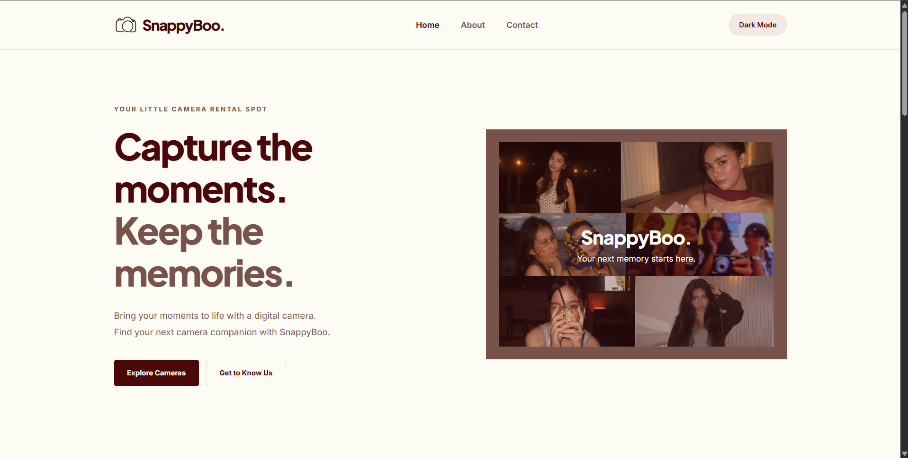

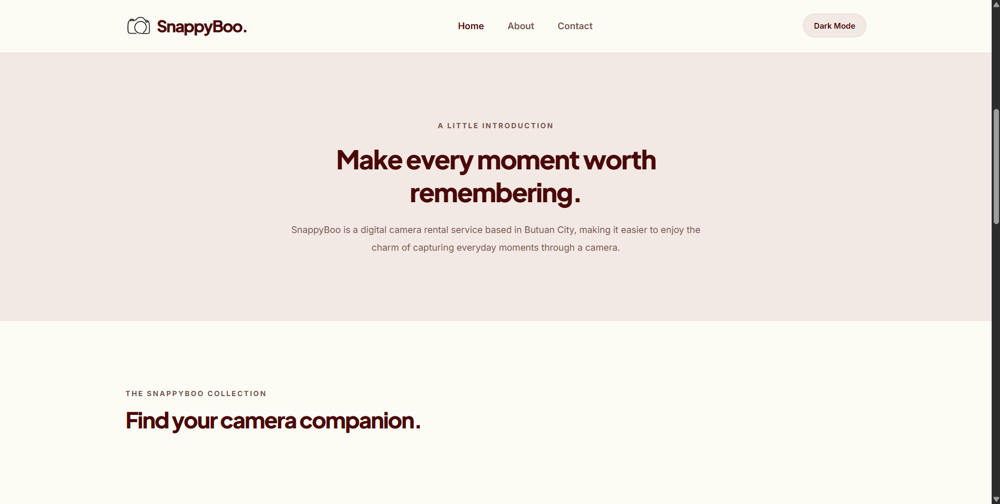

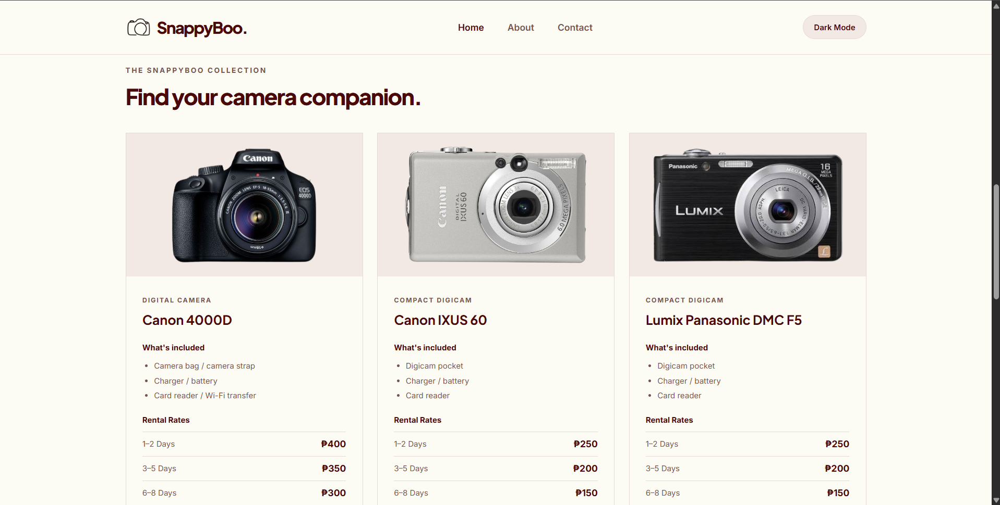

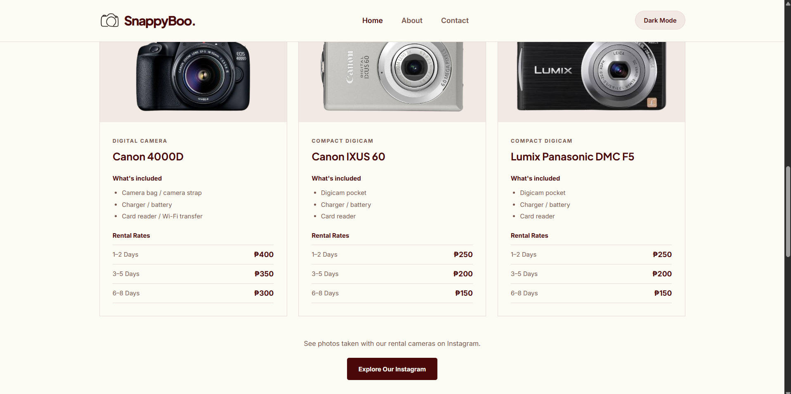

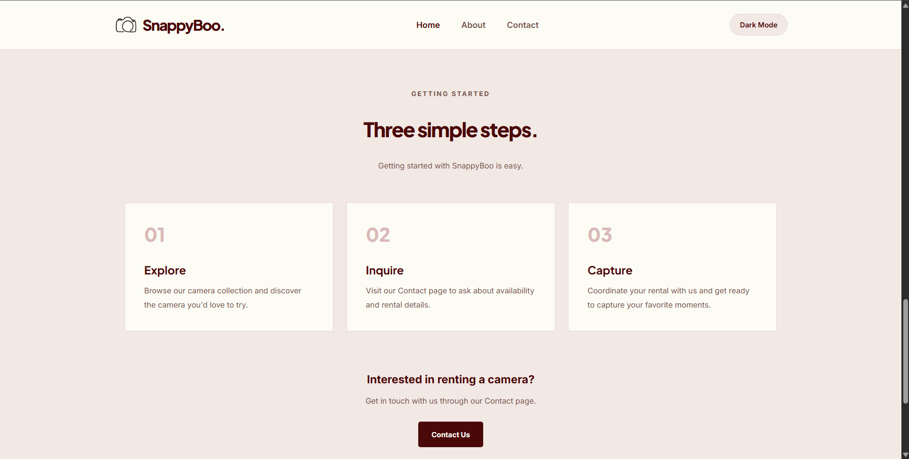

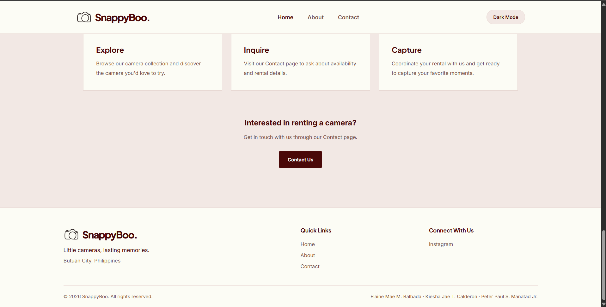

### 6.2 About Page

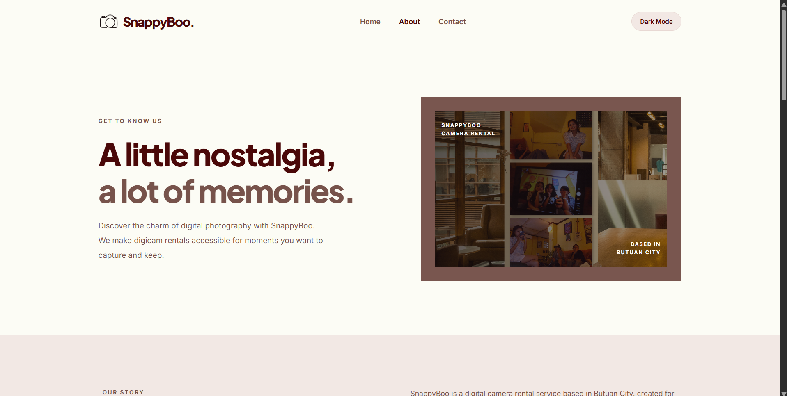

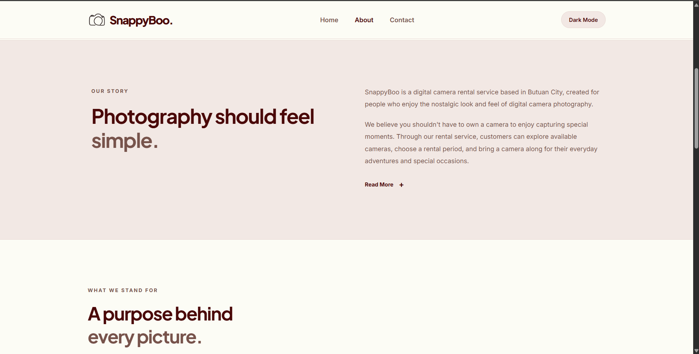

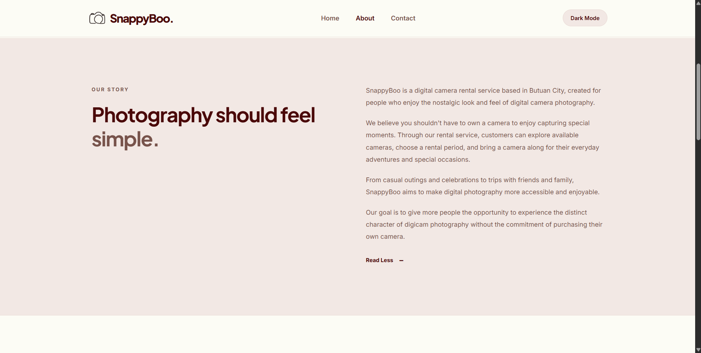

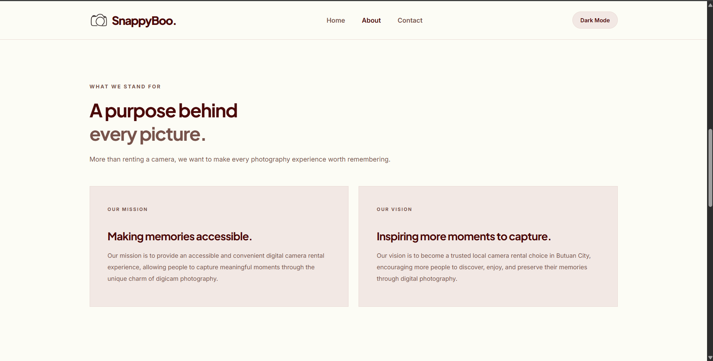

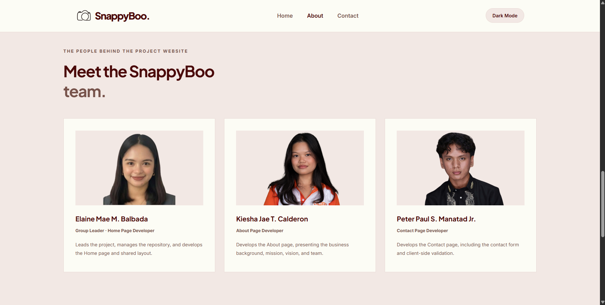

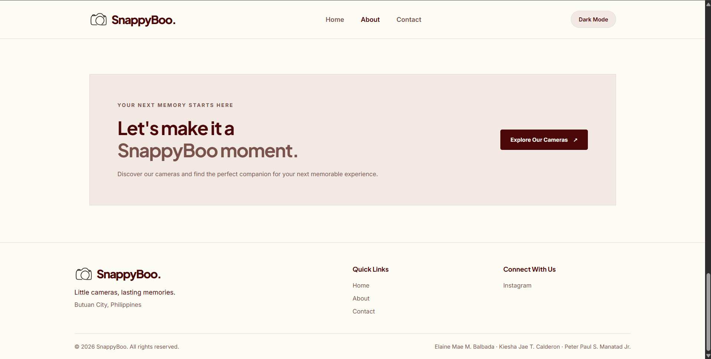

### 6.3 Contact Page

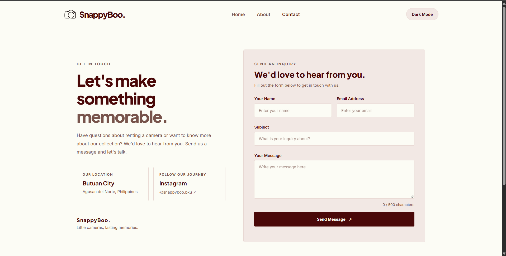

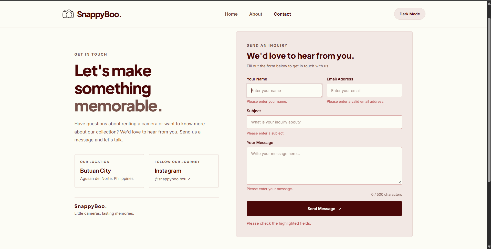

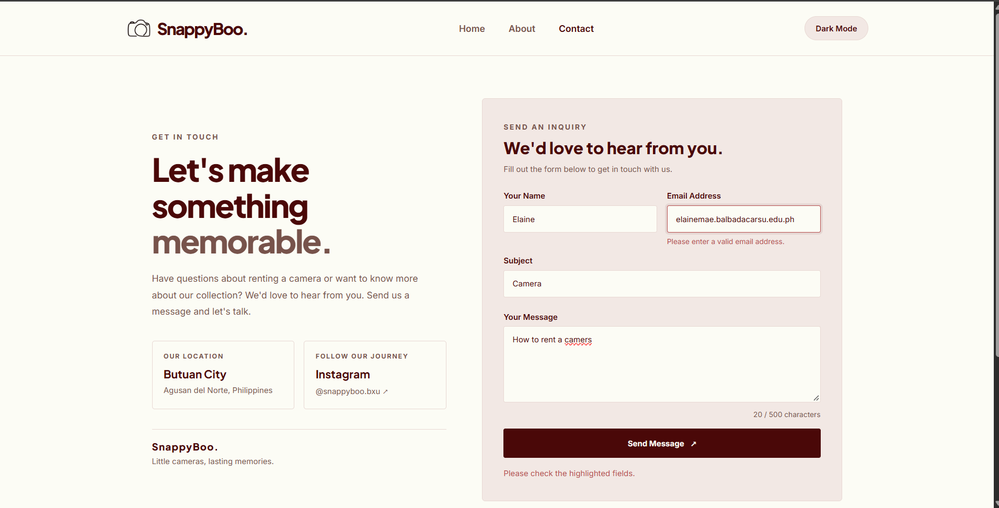

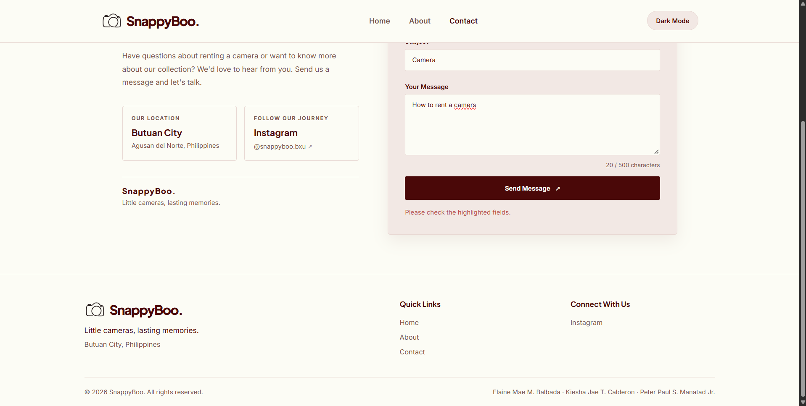

## 7. Project Structure

The project follows Laravel's standard directory organization. The following are the main folders and files used in the application:

```text
snappyboo-camera-rental/
│
├── app/                       # Application logic
├── bootstrap/                 # Framework bootstrapping
├── config/                    # Application configuration
│
├── database/
│   ├── factories/
│   ├── migrations/
│   ├── seeders/
│   └── database.sqlite        # Local SQLite database (not tracked)
│
├── public/
│   ├── css/
│   │   ├── app.css
│   │   ├── home.css
│   │   ├── about.css
│   │   └── contact.css
│   │
│   ├── js/
│   │   ├── theme.js
│   │   ├── home.js
│   │   ├── about.js
│   │   └── contact.js
│   │
│   └── images/                # Website images and assets
│
├── resources/
│   └── views/
│       ├── layouts/
│       │   └── app.blade.php
│       ├── home.blade.php
│       ├── about.blade.php
│       └── contact.blade.php
│
├── routes/
│   └── web.php                # Website routes
│
├── storage/                   # Application storage
├── tests/                     # Application tests
├── screenshots/               # Website screenshots
│
├── artisan
├── composer.json
├── composer.lock
├── package.json
├── package-lock.json
├── vite.config.js
└── README.md
```

## 8. Website Routes

The application uses Laravel web routes to display its three main pages.

| Page | Route | Description |
|---|---|---|
| Home | `/` | Displays the main landing page |
| About | `/about` | Displays business and team information |
| Contact | `/contact` | Displays contact details and inquiry form |

## 9. Installation and Running Instructions

### Prerequisites

Make sure the following are installed on your computer:

- PHP 8.3 or later
- Composer
- Node.js and npm
- Git
- PHP PDO SQLite extension

### Step 1. Clone the Repository

```bash
git clone https://github.com/elainemaebalbada/Lara-Proj-GWLM1-Balbada-Calderon-Manatad.git
```

### Step 2. Navigate to the Project Directory

```bash
cd Lara-Proj-GWLM1-Balbada-Calderon-Manatad
```

### Step 3. Install PHP Dependencies

```bash
composer install
```

### Step 4. Create the Environment File

For Windows PowerShell:

```powershell
Copy-Item .env.example .env
```

### Step 5. Generate the Application Key

```bash
php artisan key:generate
```

### Step 6. Create the SQLite Database File

For Windows PowerShell:

```powershell
New-Item -ItemType File -Path database/database.sqlite
```

### Step 7. Run Database Migrations

```bash
php artisan migrate
```

### Step 8. Install Frontend Dependencies

```bash
npm install
```

### Step 9. Build Frontend Assets

```bash
npm run build
```

### Step 10. Start the Laravel Development Server

```bash
php artisan serve
```

### Step 11. Open the Website

Visit the following address in your browser:

`http://127.0.0.1:8000`

## 10. Version Control and Collaboration

The project was developed collaboratively using Git and GitHub.

Each member worked on an assigned development branch to manage individual contributions. Completed changes were submitted through Pull Requests and merged into the main branch.

This workflow helped organize individual responsibilities, track code changes, and integrate the three website pages into one Laravel application.

**GitHub Repository:** [SnappyBoo Camera Rental](https://github.com/elainemaebalbada/Lara-Proj-GWLM1-Balbada-Calderon-Manatad)

---

**SnappyBoo Camera Rental**
*Group Project – GWLM1*
*Elaine | Kiesha | Peter*
